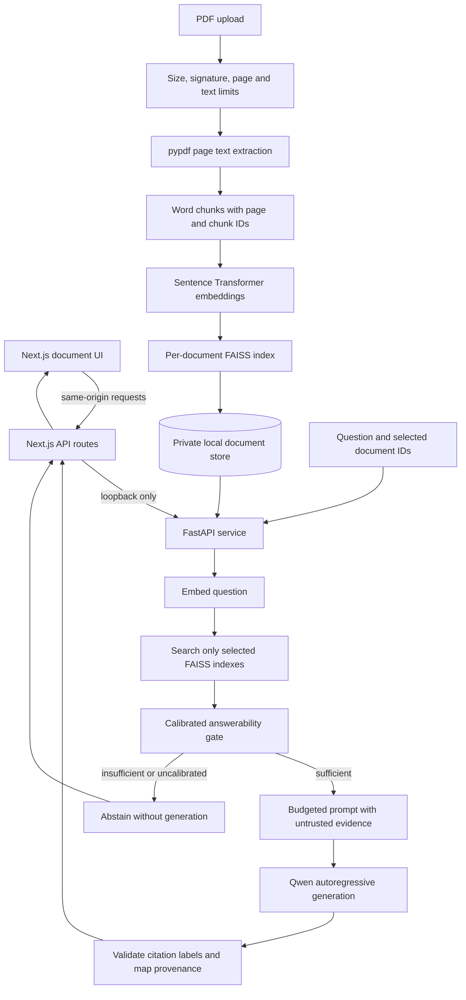
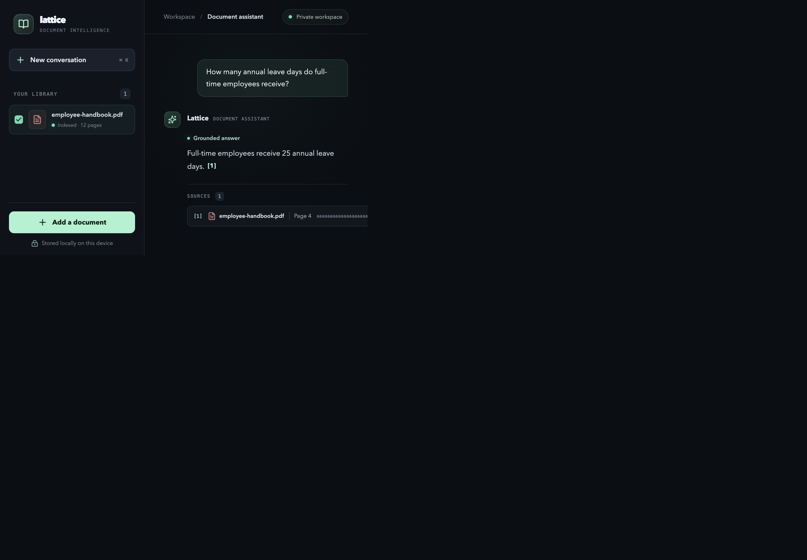
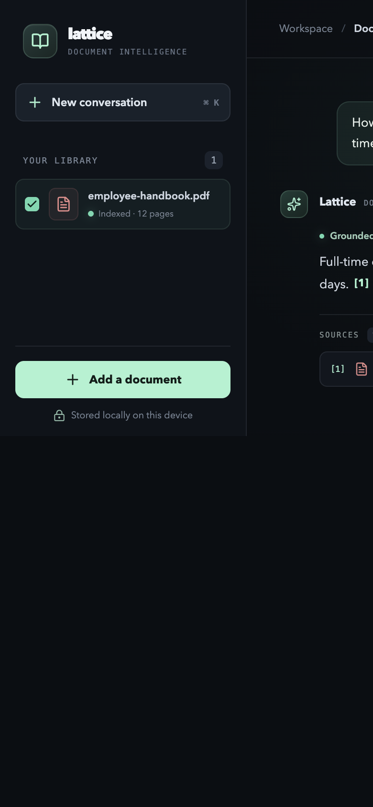

# AI Document RAG Assistant

A local-first document question-answering project using FastAPI, FAISS,
Sentence Transformers, Qwen, and a responsive Next.js interface. Users upload
PDFs, select the documents to search, and receive answers with backend-derived
source references. This is a portfolio prototype, not a production or
multi-user service.

## Verified capabilities

- Extracts text per PDF page, splits it into deterministic word chunks, and
  retains document, page, and chunk provenance.
- Embeds and indexes each document separately; retrieval is restricted to the
  document IDs selected for that question.
- Uses a labeled retrieval calibration set to fail closed when no calibrated
  answerability gate is configured or evidence is below the calibrated cutoff.
- Generates answers with Qwen2.5-0.5B-Instruct, enforces a prompt token budget,
  and validates generated citation labels against retrieved sources.
- Persists document metadata, extracted chunks, per-document FAISS indexes,
  and private source PDFs locally.
- Provides FastAPI upload/list/health/ask/PDF-view routes and a Next.js
  App Router UI with same-origin server-side API proxies.
- Keeps conversation history in browser memory only; prior turns are not sent
  to the model as context.

## Architecture and RAG data flow



In short: embeddings help retrieval find relevant passages; the generator
produces language from those passages. Retrieval and generation can fail
independently, and source links preserve provenance but do not by themselves
prove that every generated claim is entailed by its source.

## Setup and startup

Use Python 3.9 or newer:

```bash
python -m venv .venv
source .venv/bin/activate
python -m pip install -r requirements.txt
python -m pip install -r requirements-dev.txt
```

Start one local worker, bound to loopback:

```bash
uvicorn backend.api.app:app --host 127.0.0.1 --port 8000 --workers 1
```

FastAPI's lifespan startup loads the shared `all-MiniLM-L6-v2` embedding model
and persisted document indexes once. Qwen's generator object is initialized
with the service but loads its tokenizer and weights lazily on the first
answerable question. Model downloads, if needed, go to the Hugging Face cache,
not this repository. For offline use, set `HF_HUB_OFFLINE=1` and
`TRANSFORMERS_OFFLINE=1` before startup; missing embedding weights make the
service unhealthy, and missing Qwen weights produce HTTP 503 on inference.

The standard fake-based suite and the real-model smoke tests are:

```bash
python -m unittest discover -s tests -v

python -m evaluation.evaluate_retrieval

RUN_QWEN_INTEGRATION=1 \
HF_HUB_OFFLINE=1 \
TRANSFORMERS_OFFLINE=1 \
OMP_NUM_THREADS=1 \
MKL_NUM_THREADS=1 \
OPENBLAS_NUM_THREADS=1 \
python -m unittest tests.test_api_real_model tests.test_qwen_integration -v
```

The opt-in test needs both model weights already cached and never downloads
them. Thread limits are needed for the local macOS FAISS/PyTorch wheels, which
may load conflicting OpenMP runtimes.

## API

Interactive API documentation is at `http://127.0.0.1:8000/docs`.

### `GET /health`

Reports `ready` when the embedding service and indexes initialized. The Qwen
state is initially `lazy`; if Qwen fails at inference, health becomes
`unavailable` and the endpoint returns HTTP 503.

### `POST /documents/upload`

Upload one multipart field named `file`. The file needs a `.pdf` extension,
PDF magic bytes, and must be readable and unencrypted. Successful ingestion
returns HTTP 201:

```bash
curl -F 'file=@./handbook.pdf' http://127.0.0.1:8000/documents/upload
```

Example response:

```json
{
  "document_id": "3fc728ea6e644b9bb4a8f7570509f1fb",
  "filename": "handbook.pdf",
  "uploaded_at": "2026-11-18T00:00:00+00:00",
  "page_count": 12,
  "chunk_count": 35,
  "source_available": true
}
```

PDF ingestion is synchronous: the request stays in a processing state until
extraction, chunking, embedding, and indexing finish. There is no background
queue or percentage progress endpoint.

### `GET /documents`

Lists indexed document metadata. The generated document ID is stable across
service restarts and should be sent back by the client when asking questions.
Only successfully indexed documents appear in this list. `source_available`
indicates whether the original PDF can be opened; documents indexed before
Milestone 5 may not have a retained original.

### `GET /documents/{document_id}/file`

Streams the original PDF for a known document ID with a private, no-store
response. The route validates the opaque ID and resolves only files under that
document's storage directory. The web app opens a page using a PDF fragment
such as `#page=4`. This route is not an authorization mechanism; keep both
servers bound to loopback.

### `POST /ask`

The request must name one or more document IDs. Retrieval is restricted to
those documents; there is no implicit search over other uploads.

```bash
curl http://127.0.0.1:8000/ask \
  -H 'Content-Type: application/json' \
  -d '{
    "question": "How much annual leave do full-time employees receive?",
    "document_ids": ["3fc728ea6e644b9bb4a8f7570509f1fb"],
    "top_k": 3
  }'
```

The response includes `answer`, `status`, `citations`, `abstention_reason`, and
the retrieval assessment when available:

```json
{
  "answer": "Full-time employees receive 25 days of annual leave. [1]",
  "status": "answered",
  "citations": [
    {
      "citation": 1,
      "document_id": "3fc728ea6e644b9bb4a8f7570509f1fb",
      "page": 4,
      "chunk_id": "3fc728ea6e644b9bb4a8f7570509f1fb:p4:c1"
    }
  ],
  "abstention_reason": null,
  "retrieval_assessment": {
    "sufficient": true,
    "empirical_precision": 1.0,
    "calibration_id": "handbook-calibration",
    "reason": null
  }
}
```

Status values are `answered`, `abstained`, and `calibration_required`.
Without a calibration file the service fails closed: it returns
`calibration_required` and does not call Qwen. If calibration rejects the
retrieved evidence, the response is `abstained`.

### Validation and error behavior

| Condition | HTTP response |
|---|---|
| Upload body/file exceeds the configured limit | 413 `upload_too_large` |
| Non-PDF filename | 415 `pdf_extension_required` |
| Malformed, encrypted, or unreadable PDF | 422 `invalid_pdf` |
| Valid PDF with no extractable text | 422 `empty_document` |
| Missing selected document ID | 404 `selected_document_not_found` |
| Invalid question or document selection | 422 validation error |
| Embedding model unavailable at startup | 503; `/health` is unavailable |
| Qwen unavailable during generation | 503 `generation_model_unavailable` |
| Persistent document data is corrupt | 500 `document_store_error` |

Encrypted PDFs, scanned-image PDFs (no OCR), zero-text documents, and malformed
files are not indexed. Each upload is limited to 10 MiB by default, 200 pages,
and 1,000,000 extracted text characters. A question is limited to 2,000
characters, a request to 20 selected document IDs, and retrieval to 10 chunks.
Limits can be adjusted with `RAG_MAX_UPLOAD_BYTES`, `RAG_MAX_PAGES`,
`RAG_MAX_TEXT_CHARACTERS`, `RAG_MAX_QUESTION_CHARACTERS`,
`RAG_MAX_SELECTED_DOCUMENTS`, `RAG_TOP_K`, and `RAG_MAX_PROMPT_TOKENS`.

## Ingestion, indexing, and persistence

`pypdf` extracts text page by page. The deterministic word chunker carries the
page number and generated chunk ID into metadata; the text is embedded with
the shared `all-MiniLM-L6-v2` model and indexed as normalized vectors using
FAISS inner product. Source PDFs are retained for page citations and viewers,
in addition to extracted text and vectors.

By default, `.data/` stores:

- `documents.json`: document ID, sanitized filename, upload time, page and
  chunk counts. It is replaced atomically.
- `documents/<document-id>/chunks.json`: extracted chunk text and its
  immutable document/page/chunk provenance.
- `documents/<document-id>/source.pdf`: the original uploaded PDF, retained
  privately so a citation can open the corresponding page.
- `documents/<document-id>/vectors.faiss`: that document's FAISS index.

Each document has a separate index. For a question, the service embeds the
query once, searches only the selected per-document indexes, and merges their
ranked hits. On restart it loads the saved FAISS indexes rather than embedding
the stored chunks again. New document files are prepared in a staging
directory and renamed into place before the metadata manifest is atomically
updated. The local data directory is permission-restricted and ignored by Git.
It contains private original PDFs, extracted document text, and vectors;
protect and back it up accordingly. Do not commit it.

## Milestone 5: Next.js document assistant





Screenshots use synthetic preview data; no private PDFs or document contents
are included.

The interface uses the Next.js App Router, React, TypeScript, and responsive
CSS. Start FastAPI as above, then in a second terminal:

```bash
cp frontend/.env.example frontend/.env.local
cd frontend
npm ci
npm run dev
```

Open `http://127.0.0.1:3000`. The `RAG_API_BASE_URL` setting is server-only and
must point to a loopback HTTP address; the API proxy rejects non-loopback
targets. The frontend server also binds to `127.0.0.1`. Do not add a
`NEXT_PUBLIC_` prefix to backend configuration or expose either service to a
network without authentication, ownership checks, request limits, and resource
protections.

The Next.js route handlers proxy health, document listing, upload, questions,
and PDF viewing to FastAPI. Upload and question request bodies are bounded by
the proxy before forwarding and are validated again by FastAPI. The sidebar
lists indexed documents and sends only checked document IDs to `/ask`. Upload
shows a processing state while the synchronous backend extracts, chunks,
embeds, and persists the PDF; it does not claim percentage progress.

RAG concepts in the interface:

- **Embeddings and retrieval:** the backend maps question and chunk text into
  vectors, then selects the most relevant chunks only from checked documents.
  Selection is a retrieval scope, not a model instruction to search the whole
  library.
- **Grounding and generation:** Qwen generates autoregressively, predicting
  answer tokens from the question and retrieved evidence supplied in its
  prompt. The model does not receive frontend conversation history.
- **Source provenance:** citation number, document ID, page, and chunk ID come
  from the backend. The UI resolves the document ID to the listed filename and
  links to that document's retained PDF page; it does not make up citations.
- **Errors and hallucinations:** bad retrieval and bad generation are distinct
  failure modes. Calibration can make the backend abstain when evidence is
  insufficient, but similarity scores are not probabilities and citations do
  not prove factual entailment. Verify consequential claims in the source.

Conversation messages live only in browser memory and disappear on reload.
Follow-up questions are independent `/ask` requests; no persistent chat history
or multi-turn model context is implemented. PDFs are retained in `.data/`;
`source_available: false` is shown for older indexed documents whose original
file was previously discarded.

Frontend checks:

```bash
cd frontend
npm test
npm run lint
npm run typecheck
npm run build
```

## Calibration and answerability

No universal similarity cutoff is safe across documents. To enable answering,
set `RAG_CALIBRATION_FILE` to a JSON list of labeled top-hit score examples
measured with the same embedding model and representative document collection:

```json
[
  {"score": 0.81, "answerable": true},
  {"score": 0.42, "answerable": false},
  {"score": 0.72, "answerable": true},
  {"score": 0.55, "answerable": false}
]
```

Both labels are required. The current service uses `minimum_precision=1.0` and
chooses the highest-recall cutoff that produced no false positives in the
provided calibration examples. The calibration ID is the configuration
filename without its extension. This empirical result is not a probability
and does not guarantee future precision. If no cutoff meets the objective,
the gate rejects all queries. Recalibrate when the embedding model or document
collection changes; do not use the tiny sample evaluation set as a production
calibration set.

## Runtime and security

- **FastAPI lifespan** owns long-lived resources: it creates the embedding
  model, loads persisted indexes and metadata, and creates one Qwen generator.
  Model initialization errors are logged and surfaced through `/health`.
- **Dependency injection** is used at the service boundary: factories can
  provide fake embedding/generation components in tests. API handlers retrieve
  the one lifespan-created service from application state rather than
  reloading models per request.
- **Latency and concurrency:** embedding model initialization can delay
  startup; Qwen loads on the first generation, which is slower than subsequent
  requests. A process-local semaphore allows only one upload/indexing or
  question-generation operation at a time. This is intentionally a single
  worker prototype; multiple workers would duplicate models and do not share
  the in-memory document registry or lock.
- **API validation:** multipart uploads are bounded before form parsing and
  during temporary-file writes. The service limits file count, field count,
  PDF pages/text, question length, selected IDs, and `top_k`. Generated IDs
  are opaque identifiers, not authorization.
- **Local-only prototype:** there is no authentication, user ownership,
  tenant isolation, rate limiting, or durable multi-process coordination.
  Bind to `127.0.0.1`; do not expose this service to a network or use it for
  sensitive multi-user data. Before any public deployment, add authentication,
  per-user document authorization, request/rate limits, process and storage
  isolation, monitoring, and appropriate resource/time limits.
- Retrieved PDF text is untrusted data and is not executed. The prompt asks
  Qwen to ignore embedded instructions, but prompt wording does not eliminate
  prompt-injection or hallucination risk.

## Milestone 6: Evaluation and measured results

### Retrieval

Run the labeled retrieval evaluation with:

```bash
python -m evaluation.evaluate_retrieval
```

The corpus contains **4 synthetic passages** and **4 labeled answerable
queries**. Hit@K is the fraction of queries with at least one relevant passage
in the top K. MRR@3 is the mean reciprocal rank of the first relevant passage
within the top three (zero when no relevant passage is found).

| Metric | Result | Sample |
|---|---:|---:|
| Hit@1 | 1.000 (4/4) | 4 queries |
| Hit@3 | 1.000 (4/4) | 4 queries |
| MRR@3 | 1.000 | 4 queries |

These are results on a tiny synthetic corpus, not evidence of general retrieval
quality. Four short, distinct policy passages make this task unusually simple.

### Answer, abstention, and citation checks

The opt-in real-model RAG test uses **8 labeled calibration examples** (4
answerable, 4 unanswerable) and **2 evaluation cases** (1 answerable, 1
unanswerable), with the cached `all-MiniLM-L6-v2` and
`Qwen/Qwen2.5-0.5B-Instruct` models. The calibration data is small, synthetic,
and semantically related to the evaluation corpus; it is not an independent
benchmark.

| Check | Result | What was actually checked |
|---|---:|---|
| Expected answerable chunk retrieved in top 3 | 1/1 | Expected chunk ID was present in the real retrieval results |
| Answer reference check | 1/1 | Generated answer contained the labeled answer reference (`25`) |
| Citation provenance | 1/1 | Every citation label in the response mapped to a returned source whose document/page/chunk matched an actual retrieved hit; the expected source was cited |
| Labeled support span in cited chunk | 1/1 | The expected text span (`25 days`) was in the actual retrieved chunk for the expected citation |
| Unanswerable calibrated abstention | 1/1 | The held-out office-location query was rejected by the calibrated gate |

On this sample, the answerable retrieval error count was **0/1** and the
generation-or-citation regression count after successful retrieval was **0/1**.
Those are diagnostic outcomes on one answerable example, not reliable rates.
The answer-reference check is a narrow automated regression check, not a
semantic factuality metric. The model also generated extra claims from other
retrieved passages; their individual entailment was not independently scored.
The support-span check establishes that a labeled span occurs in the cited
retrieved chunk; it does not prove that every sentence in an answer is
faithfully entailed. A larger, independently authored and human-adjudicated
evaluation set is needed for meaningful answer-quality claims.

### Local performance sample

One cached-model run was measured on **Apple M4, arm64, macOS 26.6.2**,
Python **3.9.6**, with Sentence Transformers **5.1.2**, PyTorch **2.8.0**,
FAISS CPU **1.13.0**, Transformers **4.57.6**, and FastAPI **0.128.8**.
The embedding model was `sentence-transformers/all-MiniLM-L6-v2` on MPS;
Qwen `Qwen/Qwen2.5-0.5B-Instruct` ran on CPU. The frontend used Node
**24.14.1**, Next.js **16.4.6**, and React **19.3.1**.

| Operation | Observed time | Conditions |
|---|---:|---|
| Embedding model load | 0.439 s | Cached local model |
| Calibration FAISS index build | 0.292 s | 4 synthetic passages |
| FastAPI startup | 0.005 s | Embedding model already loaded and injected |
| Synthetic PDF upload and indexing | 0.034 s | One-page, one-chunk PDF; models already loaded |
| First API answer | 6.675 s | Includes retrieval, lazy Qwen setup and generation |
| Warm repeated API answer | 1.481 s | Same question and document, same process |
| Calibrated abstention | 0.035 s | No Qwen generation |

These are single observations, not p50/p95 benchmarks. They depend on warm
filesystem/model caches, a tiny PDF, device placement, and background system
load; they do not predict larger-document latency. Qwen's lazy model load is
included in first-answer latency and is not timed separately. The clearest
measured bottleneck is autoregressive Qwen inference: a warm answer still took
about 1.48 s in this small smoke test, while a calibrated abstention avoided
generation. Measure representative document sizes and repeated trials before
considering quantization, acceleration, batching, or a different serving
architecture.

## Milestone 6: Security review and deployment readiness

### Controls verified in this local prototype

- Uploads have a configured byte limit, PDF signature/extension checks,
  malformed/encrypted PDF handling, page and extracted-text limits, and
  controlled private temporary storage.
- Document IDs and source paths are validated; source resolution is confined
  to the document store. The Next.js proxy accepts only loopback backend URLs,
  bounds request bodies, and validates PDF IDs.
- Selected document IDs scope retrieval to their per-document indexes.
- React displays model output as text rather than interpreting it as HTML.
- Retrieved PDF text is treated as untrusted prompt data, and the prompt size
  is bounded. This is prompt-level mitigation, not a deterministic defense
  against prompt injection.
- The documented Next.js and FastAPI configurations bind to `127.0.0.1`.

### Finding and unresolved risks

| Severity | Finding | Status |
|---|---|---|
| High | Document listing and PDF retrieval have no authentication or ownership checks. Any caller who can reach the local service can list documents or fetch a PDF by ID. | Accepted only for a loopback-only, single-user prototype; not fixed by opaque IDs or retrieval scoping. |

Cross-user access cannot be meaningfully tested because there are no user
identities or ownership records. The API also has no rate limiting or explicit
HTTP/model-operation timeout. Inference concurrency is limited by an
in-process semaphore, which is not shared across workers. Prompt injection and
model hallucinations remain possible, and citations are provenance mappings,
not proof of claim entailment. **Do not expose either service to a network or
use it for multi-user/private workloads.** A public deployment requires
authentication, per-user authorization and storage isolation, request/rate
limits, explicit operation timeouts, monitoring, and security testing.

Both `npm audit` and `npm audit --omit=dev` reported **zero known dependency
vulnerabilities** in the current frontend lockfile.

## Engineering notes and portfolio summary

### Key AI concepts

- **Embeddings:** the sentence-transformer maps text to vectors so semantically
  related questions and passages can be compared even when wording differs.
- **Cosine similarity:** vectors are normalized and FAISS uses inner product;
  for normalized vectors, inner product equals cosine similarity. Similarity
  ranks candidates; it is not a probability that an answer is true.
- **Chunking:** splitting page text into bounded overlapping word spans gives
  retrieval focused evidence while retaining page/chunk provenance. Chunks
  that are too small lose context; chunks that are too large dilute retrieval
  and consume prompt budget.
- **FAISS and retrieval:** FAISS searches dense vectors for top-ranked chunks.
  The selected document IDs restrict which indexes are searched; ranking
  quality is measured separately from answer generation.
- **RAG and Qwen inference:** retrieval places candidate evidence in the
  prompt; Qwen then generates tokens autoregressively, one token at a time.
  The language model can still misread or overstate the retrieved text.
- **Token budgets:** the prompt budget bounds evidence size to fit the model's
  context and limits; evidence is shortened deterministically when needed.
- **Grounding and provenance:** the backend carries immutable document/page/
  chunk identifiers outside generated text, then maps valid model citation
  labels back to those sources. A citation proves where a source came from,
  not that the source logically supports every claim.
- **Calibration:** answerability is a decision cutoff selected from labeled
  retrieval examples. Its measured precision on a tiny calibration set is not
  a probability or a guarantee on new documents.

### Case study

**Problem:** make a small PDF collection searchable and answerable without
sending documents to a hosted model service.

**Approach:** built a local PDF ingestion pipeline, page-aware chunking,
normalized sentence embeddings, per-document FAISS indexes, calibrated
retrieval gating, and Qwen answer generation. Wrapped it in a FastAPI service
and a responsive Next.js UI with selected-document retrieval and provenance-
backed PDF citations.

**Measured result:** Hit@1/Hit@3/MRR@3 were each **1.000 on 4 synthetic
retrieval queries**. The cached real-model smoke test passed its one
answer-reference, citation-source/support-span, and unanswerable-abstention
checks. These small sample results are reported with their limits, not as
general accuracy claims.

**CV-ready statement:** *Built a local-first PDF RAG assistant with page-aware
chunking, Sentence Transformers, per-document FAISS retrieval, calibrated
abstention, Qwen2.5 grounded generation, and FastAPI/Next.js interfaces;
evaluated retrieval and citation behavior on labeled synthetic cases and
documented security, latency, and benchmark limitations.*

## Test results and limitations

Latest offline backend suite: **35 tests, 33 passed, 2 opt-in real-model tests
skipped**. The separate cached real-model suite passed **2/2 tests**. Retrieval
metric regression tests passed **4/4**. `pip check` reported no broken Python
requirements. Frontend verification: **6 tests passed**; lint, TypeScript
checks, and the optimized production build passed, with all frontend routes
generated. The local production proxy smoke test completed PDF upload, listing,
viewing, and a selected-document ask that returned `calibration_required`
without a configured calibration file.

The real-model tests never download weights and are not run by the default
suite. Limitations also include no OCR, no document deletion endpoint, retained
original PDFs using local storage, a small synthetic calibration corpus,
no persistent conversation memory, and single-process concurrency. The
application is suitable for a local portfolio demo, **not production or
public deployment**.
# ai-document-rag-assistant
